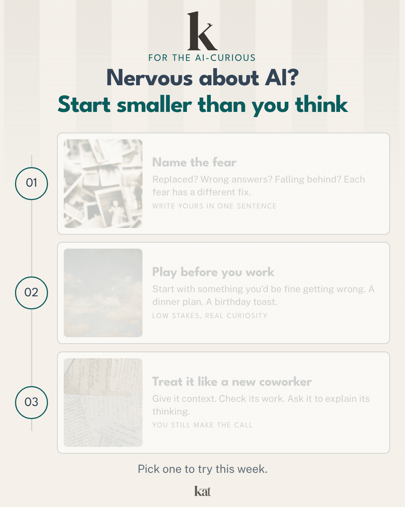

# Animated infographic skill

A Claude skill that turns your expertise into animated, on-brand LinkedIn infographics. Your logo starts big at the top, hops through the content as each piece lights up, then flies home, so the GIF loops cleanly in the feed.

## What it does

1. **Sets up your brand once.** Send your logo, colors or brand guidelines, fonts, and a few photos or textures you like. It pulls a palette from your logo if you don't have one, downloads open fonts, and checks contrast so text stays readable.
2. **Asks what you want to teach.** Start with: *"I want to create an infographic to teach [who] how to [what]."*
3. **Asks a few questions** about the shape of the idea (steps, types, right vs wrong, a system).
4. **Uses your thinking.** Paste notes, a framework, or a past post.
5. **Picks a format** from nine layouts: grid, bucket columns, steps, do-vs-don't layers, orbit, flow engine, phrase tree, modules-to-recipes, org structure.
6. **Renders a looping GIF, an MP4, and a still PNG** at LinkedIn's 4:5 size, under its 5 MB GIF limit.
7. **Takes edits and remembers them** so the next one starts closer.

## Install

1. [Download the skill zip](https://github.com/krettura/ai-skills-library/raw/main/downloads/animated-infographic-skill-by-kat.zip) (no GitHub account needed).
2. In Claude, turn on code execution (Settings > Capabilities).
3. Upload the zip under Skills.
4. Start a chat with "I want to create an infographic to teach..."

After brand setup, Claude hands you a copy of the skill with your brand built in. Upload that one instead and you skip setup from then on.

## Posting tip

Upload the GIF through LinkedIn's photo button so it loops. The video button freezes it.

## Notes

- Two formats (grid and steps) are fully tested; the other seven are written as layout recipes.
- Paid or custom fonts need the font file. Open fonts download automatically.
- Logo works best as a transparent PNG or SVG of the icon on its own.

Built by Kat Rettura.
